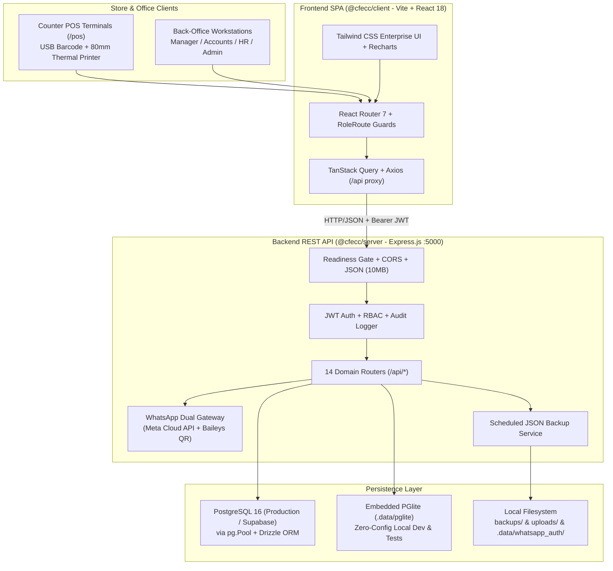
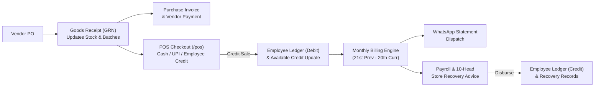

# CFECC Stores Management System — Complete Project Documentation (Pin-to-Pin)

**Organization:** Coromandel Fertilisers Employees Co-operative Consumers Society Ltd. (CFECC)  
**Registration:** Regd No: B-1463 • Visakhapatnam, Andhra Pradesh, India  
**System Name:** CFECC Stores Management System (Enterprise Retail, Inventory, POS, Employee Credit & Monthly Payroll Recovery Platform)  
**Version:** 1.0.0 (`cfecc-stores-management-system`)  

---

## Table of Contents

1. [Executive Summary & Vision](#1-executive-summary--vision)
2. [System Architecture & Technology Stack](#2-system-architecture--technology-stack)
3. [Repository & Directory Structure](#3-repository--directory-structure)
4. [Security, Authentication & RBAC Matrix](#4-security-authentication--rbac-matrix)
5. [Core Business Logic & Financial Formulas](#5-core-business-logic--financial-formulas)
6. [Complete Database Schema (PostgreSQL / PGlite)](#6-complete-database-schema-postgresql--pglite)
7. [Complete Backend REST API Reference](#7-complete-backend-rest-api-reference)
8. [Frontend Application Architecture (Routes, Pages & Components)](#8-frontend-application-architecture-routes-pages--components)
9. [WhatsApp Dual-Gateway Integration (Meta Cloud API & Baileys)](#9-whatsapp-dual-gateway-integration-meta-cloud-api--baileys)
10. [Legacy FoxPro Data Migration & Verification](#10-legacy-foxpro-data-migration--verification)
11. [Database Backup, Restore & Retention Engine](#11-database-backup-restore--retention-engine)
12. [Environment Configuration & CLI Scripts](#12-environment-configuration--cli-scripts)
13. [Testing & Quality Assurance](#13-testing--quality-assurance)
14. [Dedicated Server Production Deployment](#14-dedicated-server-production-deployment)

---

## 1. Executive Summary & Vision

The **CFECC Stores Management System** is a centralized, full-stack Enterprise Resource Planning (ERP) platform engineered for **Coromandel Fertilisers Employees Co-operative Consumers Society Ltd. (CFECC)** in Visakhapatnam, Andhra Pradesh.

It replaces legacy FoxPro `.DBF` systems with a unified **PostgreSQL** (and zero-config embedded **PGlite**) relational platform integrating:
- **Member / Employee Master & 11-Tab KYC Profile:** Cooperative Society numbers (`cs_no`), HR numbers (`hr_no`), credit limits, share capital, thrift deposits, domestic/festival advance balances, salary structures, bank details, and document vaults.
- **Items Master & Dual-Batch Inventory:** 1,852+ store commodities with dual-tier pricing (regular `selling_price` vs. subsidized `employee_price`), dual-batch FIFO tracking (`batch1` / `batch2`), HSN codes, and GST slab tracking (CGST/SGST/IGST/VAT).
- **Purchasing & 3-Way Matching:** Vendors Master, Purchase Orders (`PO`), Goods Receipt Notes (`GRN`) with accepted/rejected quantities and expiry tracking, Purchase Invoices, and Vendor Payments.
- **High-Speed Point of Sale (POS):** Fullscreen cashier terminal (`/pos`) supporting USB barcode scanners, shift open/close with Z-Reports, Cash, UPI, Employee Monthly Credit, and Meal Coupon deductions.
- **Monthly Billing Engine:** Automated 21st-to-20th billing cycle statement generation, double-entry `employee_ledger` reconciliation, direct receipt payments, and bulk WhatsApp dispatch.
- **Cooperative Payroll & 10-Head Store Recovery:** Automated calculation of monthly store recovery advice across 10 cooperative society heads, eliminating duplicate recoveries.
- **Business Intelligence & Compliance Reports:** Employee outstanding, inventory valuation, sales performance, inward purchase registers, vendor/item summaries, GRN registers, GST ITC, and GSTR-3B slab summaries.

---

## 2. System Architecture & Technology Stack

### 2.1 High-Level Architecture



### 2.2 Technology Stack

| Layer | Technology | Version / Notes |
| :--- | :--- | :--- |
| **Monorepo** | pnpm Workspaces | `@cfecc/client` + `@cfecc/server` |
| **Frontend Core** | React + TypeScript + Vite | React `^18.3.1`, TypeScript `^5.7.2`, Vite `^6.0.5` |
| **Routing & State** | React Router DOM + TanStack Query | `react-router-dom ^7.1.0`, `@tanstack/react-query ^5.62.8` |
| **Forms & Validation** | React Hook Form + Zod | `react-hook-form ^7.54.2`, `@hookform/resolvers ^3.9.1`, `zod ^3.24.1` |
| **UI & Charts** | Tailwind CSS + Lucide React + Recharts | `tailwindcss ^3.4.17`, `lucide-react ^0.469.0`, `recharts ^2.15.0` |
| **Backend Core** | Node.js + Express.js + TypeScript | `express ^4.21.2`, `tsx ^4.19.2`, `zod ^3.24.1` |
| **Database & ORM** | PostgreSQL + Drizzle ORM + PGlite | `pg ^8.13.1`, `drizzle-orm ^0.38.3`, `@electric-sql/pglite ^0.2.14` |
| **Auth & Security** | JWT + bcryptjs | `jsonwebtoken ^9.0.2`, `bcryptjs ^2.4.3` |
| **Documents & Export** | PDFKit + SheetJS (`xlsx`) + Multer | `pdfkit ^0.15.2`, `xlsx ^0.18.5`, `multer ^1.4.5-lts.1` |
| **WhatsApp** | Meta Graph API + Baileys + QRCode | `@whiskeysockets/baileys 7.0.0-rc14`, `qrcode ^1.5.4` |
| **Testing** | Vitest | `vitest ^2.1.8` (sequential server suite `--fileParallelism=false`) |

### 2.3 Database Connection & Fallback Strategy

Implemented in `apps/server/src/db/index.ts` (`initDatabase()`):
1. **Test / Explicit Embedded Mode:** If `USE_PGLITE=true` or `NODE_ENV=test`, it bypasses remote PostgreSQL and uses embedded PGlite.
2. **Remote / Dedicated PostgreSQL:** If `DATABASE_URL` is configured, it connects via `pg.Pool` (`max: 20`, `connectionTimeoutMillis: 15000`, `idleTimeoutMillis: 30000`, `keepAlive: true`). If the URL contains `supabase.co`, `pooler.supabase.com`, or `sslmode=require`, SSL is enabled (`rejectUnauthorized: false`). Transient connection errors (`ECONNRESET`, `57P01`, timeouts) are automatically retried once after 300ms.
3. **Zero-Config Fallback:** If remote connection fails or `DATABASE_URL` is empty, it automatically falls back to embedded **PGlite** stored at `.data/pglite` (cleaning stale `postmaster.pid` locks if needed).
4. **Auto-Bootstrap:** On every startup, `ensureTablesCreated()` runs idempotent `CREATE TABLE IF NOT EXISTS` / `ALTER TABLE ... ADD COLUMN IF NOT EXISTS` DDL, `syncDatabaseSequences()` aligns all PostgreSQL `SERIAL` sequences, and `index.ts` seeds initial roles/users if `users` count is `0`.

---

## 3. Repository & Directory Structure

```
CFECC_phase1/
├── .env.example                          # Root environment variable template
├── package.json                          # Workspace scripts (dev, build, start, test, db:*)
├── pnpm-workspace.yaml                   # Monorepo workspace definition (apps/*)
├── README.md                             # Project overview & quick start
├── docs/
│   ├── ARCHITECTURE.md                   # High-level architecture notes
│   ├── CFECC_COMPLETE_PROJECT_DOCUMENTATION.md  # This pin-to-pin master document
│   └── CFECC_DEDICATED_SERVER_DEPLOYMENT_GUIDE.md # On-premise server & counter setup
├── scripts/
│   ├── backup-database.bat               # Windows pg_dump nightly backup (30-day retention)
│   ├── start-cfecc-production.bat        # 1-click Windows production server launcher
│   ├── full-migration.mjs                # Safety snapshot + full FoxPro-to-Postgres migration
│   ├── import-foxpro-data.mjs            # Core DBF parser & master/operational ingest
│   ├── verify-full-migration.mjs         # Post-migration row-count & sequence verifier
│   ├── populate-all-product-images.mjs   # Product image population utility
│   └── populate-purchasing.mjs           # Purchasing data population utility
└── apps/
    ├── client/                           # React 18 + Vite SPA (@cfecc/client)
    │   ├── vite.config.ts                # Port 5173, /api -> localhost:5000 proxy
    │   └── src/
    │       ├── App.tsx                   # Route definitions + ProtectedRoute + RoleRoute
    │       ├── context/AuthContext.tsx   # JWT token & user session state
    │       ├── lib/api.ts                # Axios instance with auth interceptors
    │       ├── types/index.ts            # Shared TypeScript domain interfaces
    │       ├── components/
    │       │   ├── layout/               # AppShell, Sidebar, Header
    │       │   └── ui/                   # BarcodeSvg, FloatingActionBar, Modal, StatCard, StatusBadge, TablePagination
    │       └── pages/                    # Domain UI modules (auth, dashboard, employees, items, inventory, vendors, purchasing, pos, sales, billing, payroll, reports, settings)
    └── server/                           # Express.js REST API (@cfecc/server)
        ├── drizzle.config.ts             # Drizzle Kit configuration
        ├── tests/                        # Vitest integration & sanity test suites
        └── src/
            ├── app.ts                    # Express app factory, readiness gate, router mounts
            ├── index.ts                  # Server bootstrap, DB init, backup daemon, Baileys auto-start
            ├── config/index.ts           # Env loader, JWT, CORS, WhatsApp, client metadata
            ├── db/
            │   ├── index.ts              # PG/PGlite connection, DDL, sequence sync
            │   ├── seed.ts               # Default dev/demo roles, permissions, users
            │   ├── clean-production-init.ts # Zero-dummy-data production initializer
            │   ├── migrate.ts            # Migration runner
            │   ├── migrate-legacy-foxpro.ts # Historical VAT, ADJMAST/ADJDETL, STRDED ingest
            │   ├── reconcile-database.mjs # Database reconciliation script
            │   └── setup-supabase.ts     # Supabase setup helper
            ├── lib/foxproData.ts         # FoxPro data helpers
            ├── middleware/
            │   ├── auth.ts               # authenticateToken, requireRole, requirePermission
            │   ├── audit.ts              # logAudit -> audit_logs table
            │   └── errorHandler.ts       # ZodError & global HTTP error formatter
            ├── services/
            │   ├── baileys.service.ts    # Embedded WhatsApp Web QR gateway
            │   └── whatsapp.service.ts   # Meta Cloud API + message templates
            └── modules/                  # 14 domain modules (auth, backup, billing, dashboard, employees, inventory, items, payroll, pos, purchasing, reports, sales, vendors, whatsapp)
```

---

## 4. Security, Authentication & RBAC Matrix

### 4.1 Authentication Flow
- **JWT Bearer Tokens:** `POST /api/auth/login` verifies credentials using `bcryptjs` against `users.password_hash` and signs a JWT with `JWT_SECRET` (default expiry `24h`).
- **Readiness Gate:** All non-health requests wait up to 15 seconds for `isDatabaseReady` during cold boot (returning HTTP `503` on timeout).
- **Audit Logging:** `logAudit()` records `user_id`, `action`, `entity`, `entity_id`, `old_values` (JSONB), `new_values` (JSONB), and `ip_address` into `audit_logs`.

### 4.2 System Roles & Permissions

Five master roles are seeded in `roles`:
1. **`SUPER_ADMIN`** — Universal access across all API routes, UI pages, overrides, and settings.
2. **`STORE_MANAGER`** — Items, inventory adjustments, vendors, purchasing (PO/GRN/Invoices), sales register, and reports.
3. **`CASHIER`** — POS terminal (`/pos`), shift open/close, checkout, direct receipt payments, and POS receipts.
4. **`ACCOUNTS_OFFICER`** — Monthly billing periods, statement generation/finalization, payments, vendor payments, payroll, sales register, and reports.
5. **`HR_PAYROLL`** — Employee/Member Master directory, 11-tab KYC profiles, salary structures, documents, bulk import, and payroll calculation.

### 4.3 Default Demonstration Accounts (`pnpm db:seed`)

| Role | Username | Password | Default Landing Route |
| :--- | :--- | :--- | :--- |
| **Super Administrator** | `admin` | `Admin@123` | `/dashboard` |
| **Store Manager** | `manager` | `Manager@123` | `/dashboard` |
| **POS Cashier** | `cashier` | `Cashier@123` | `/pos` |

> **Production Note:** Run `pnpm db:prod-init` (`clean-production-init.ts`) for production deployments. It creates only the 5 roles, 17 permissions, 7 departments, 5 designations, 5 units, 5 item categories, and the single `admin` account (password configurable via `INITIAL_ADMIN_PASSWORD`) with **zero dummy data**.

---

## 5. Core Business Logic & Financial Formulas

### 5.1 End-to-End Business Lifecycle



### 5.2 POS Checkout & Dual-Batch FIFO Stock Deduction
Implemented in `apps/server/src/modules/pos/pos.router.ts` (`POST /api/pos/checkout`):
1. **Totals Calculation:**
   - $\text{Line Subtotal} = \text{quantity} \times \text{unitPrice}$
   - $\text{Taxable} = \text{Line Subtotal} - \text{discountAmount}$
   - $\text{Tax} = \text{Taxable} \times (\text{taxRate} / 100)$
   - $\text{Total Discount} = \sum \text{lineDiscounts} + \min(\max(0, \text{couponAmount}), \text{subtotal} + \text{totalTax})$
   - $\text{Total Amount} = \text{round}(\text{subtotal} - \text{Total Discount} + \text{totalTax}, 2)$
2. **Employee Credit Validation (`paymentMode === 'EMPLOYEE_CREDIT'`):**
   - Requires `employeeId` and `credit_enabled === true`.
   - Rejects checkout if $\text{totalAmount} > \text{available\_credit}$.
   - Updates `employees.current_outstanding` and `employees.available_credit`, and inserts a `CREDIT_SALE` debit into `employee_ledger`.
3. **Dual-Batch FIFO Consumption:**
   - **Case A (`batch1_qty > 0` and `reqQty <= batch1_qty`):** Consumes entirely from Batch 1 (`batch_number = 1`) at `batch1_rate`.
   - **Case B (`batch1_qty > 0` and `reqQty > batch1_qty`):** Splits into two `sale_items` rows — consumes all of `batch1_qty` at `batch1_rate` (`batch_number = 1`) and the remainder from `batch2_qty` at `batch2_rate` (`batch_number = 2`).
   - **Case C (`batch1_qty <= 0`):** Consumes from Batch 2 (`batch2_rate`) or standard `unitPrice`.
   - Updates `items.current_stock`, `batch1_qty`, `batch2_qty`, and records a negative `SALE` entry in `stock_movements`.

### 5.3 Standard Monthly Billing Cycle (21st to 20th)
Implemented in `apps/server/src/modules/billing/billing.router.ts` (`getStandardBillingCycle()`):
- If the reference day is **1st–20th**, the cycle spans **21st of previous month to 20th of current month** (`BILL-YYYY-MM`).
- If the reference day is **21st–31st**, the cycle shifts forward to **21st of current month to 20th of next month**.
- `billingDate` is always the **21st** of the closing month.
- Each `employee_invoices` statement tracks:
  $$\text{closing\_outstanding} = \text{opening\_balance} + \text{current\_purchases} + \text{adjustments} - \text{payments\_received} - \text{recoveries\_deducted}$$

### 5.4 Cooperative Society 10-Head Store Recovery Formula
Implemented in `apps/server/src/modules/payroll/payroll.router.ts` (`POST /api/payroll/calculate`):
For each `ACTIVE` employee, the system computes the **Total Store Deduction** across 10 cooperative society heads:
$$\text{Store Deduction} = \max\Big(0,\; \text{current\_month\_bills} + \text{domestic\_balance} + \text{old\_domestic\_balance} + \text{festival\_advance\_balance} + \text{misc\_deductions} + \text{unrecovered\_dues} + \text{additional\_shares} + \text{thrift\_deposit} - \text{coupon\_amount} - \text{direct\_receipt\_payments}\Big)$$
And net salary is:
$$\text{Gross Salary} = \text{basic\_salary} + \text{da} + \text{hra} + \text{other\_allowances}$$
$$\text{Net Salary} = \max(0,\; \text{Gross Salary} - (\text{statutory\_deductions} + \text{Store Deduction}))$$

---

## 6. Complete Database Schema (PostgreSQL / PGlite)

All core tables are defined in `apps/server/src/db/index.ts`, with historical FoxPro archive tables in `apps/server/src/db/migrate-legacy-foxpro.ts`.

### 6.1 Auth, RBAC & System Tables
| Table | Key Columns | Purpose |
| :--- | :--- | :--- |
| `roles` | `id`, `code` (UNIQUE), `name`, `description`, `is_system` | 5 master RBAC roles |
| `permissions` | `id`, `module`, `action`, `code` (UNIQUE), `description` | Granular module permissions |
| `role_permissions` | `id`, `role_id` (FK), `permission_id` (FK) | Role-to-permission mapping |
| `users` | `id`, `employee_id` (FK), `username` (UNIQUE), `email` (UNIQUE), `password_hash`, `full_name`, `role_id` (FK), `is_active`, `last_login_at` | System login accounts |
| `audit_logs` | `id`, `user_id` (FK), `action`, `entity`, `entity_id`, `old_values` (JSONB), `new_values` (JSONB), `ip_address`, `created_at` | Immutable audit trail |
| `system_settings` | `id`, `key` (UNIQUE), `value`, `description`, `updated_at` | Key-value runtime config (e.g., WhatsApp credentials) |
| `whatsapp_logs` | `id`, `recipient_phone`, `recipient_name`, `message_type`, `reference_type`, `reference_id`, `template_name`, `payload` (JSONB), `status`, `provider_message_id`, `error_message`, `sent_at` | WhatsApp delivery audit log |
| `backup_logs` | `id`, `filename`, `file_path`, `file_size`, `backup_type`, `status`, `record_count_summary` (JSONB), `error_message`, `created_by`, `created_at` | Backup history & metadata |

### 6.2 HR, Members & Cooperative Society Tables
| Table | Key Columns | Purpose |
| :--- | :--- | :--- |
| `departments` | `id`, `code` (UNIQUE), `name`, `is_active` | Organizational departments |
| `designations` | `id`, `department_id` (FK), `title`, `is_active` | Job titles per department |
| `employees` | `id`, `employee_code` (UNIQUE), `cs_no`, `grade`, `category`, `hr_no`, `first_name`, `last_name`, `date_of_birth`, `gender`, `profile_image_url`, `marital_status`, `mobile`, `alternate_mobile`, `email`, `current_address`, `permanent_address`, `department_id` (FK), `designation_id` (FK), `joining_date`, `employment_type`, `reporting_manager_id`, `employment_status`, `exit_date`, `credit_enabled`, `credit_limit`, `current_outstanding`, `available_credit`, `billing_cycle_day` (default 25), **Society Balances:** `share_capital`, `cum_thrift`, `thrift_deposit`, `domestic_balance`, `old_domestic_balance`, `festival_advance_balance`, `festival_month_year`, `unrecovered_dues`, `misc_deductions`, `additional_shares`, `coupon_amount`, `direct_receipt_payments`, `current_month_bills` | Master member/employee & cooperative credit profile |
| `employee_salaries` | `id`, `employee_id` (FK), `basic_salary`, `da`, `hra`, `other_allowances`, `statutory_deductions`, `net_base_salary`, `effective_date` | Salary structure history |
| `employee_bank_details` | `id`, `employee_id` (FK), `account_holder_name`, `bank_name`, `account_number`, `ifsc_code`, `branch` | Bank account for payroll |
| `employee_documents` | `id`, `employee_id` (FK), `document_type`, `document_name`, `document_url`, `file_size`, `mime_type`, `uploaded_at` | KYC document vault |

### 6.3 Items & Inventory Tables
| Table | Key Columns | Purpose |
| :--- | :--- | :--- |
| `item_categories` | `id`, `code` (UNIQUE), `name`, `description`, `parent_id`, `is_active` | 5+ product categories (`PROVISIONS`, `DAIRY`, `SNACKS`, `PERSONAL`, `STATIONERY`) |
| `units` | `id`, `code` (UNIQUE), `name`, `precision` | Measurement units (`PCS`, `KG`, `PKT`, `LTR`, `BOX`) |
| `items` | `id`, `item_code` (UNIQUE), `name`, `category_id` (FK), `subcategory`, `brand`, `description`, `unit_id` (FK), `sku`, `barcode` (UNIQUE), `hsn_code`, `purchase_price`, `selling_price`, `employee_price`, `current_stock`, `min_stock`, `reorder_level`, `tax_rate`, `image_url`, `is_active`, **Dual-Batch & Tax:** `batch1_qty`, `batch1_rate`, `batch2_qty`, `batch2_rate`, `purchase_rate1`, `purchase_rate2`, `cgst_rate`, `sgst_rate`, `vat_rate`, `physical_qty`, `stock_value`, `purchase_valuation` | Commodity catalog with dual pricing & dual-batch FIFO |
| `item_price_history` | `id`, `item_id` (FK), `old_purchase_price`, `new_purchase_price`, `old_selling_price`, `new_selling_price`, `old_employee_price`, `new_employee_price`, `reason`, `changed_by` | Audit log of price revisions |
| `stock_movements` | `id`, `item_id` (FK), `movement_type`, `reference_type`, `reference_id`, `quantity`, `unit_cost`, `balance_after`, `notes`, `created_by`, `created_at` | Real-time stock ledger |

### 6.4 Purchasing & Vendor Tables
| Table | Key Columns | Purpose |
| :--- | :--- | :--- |
| `vendors` | `id`, `vendor_code` (UNIQUE), `name`, `contact_person`, `phone`, `email`, `address`, `city`, `state`, `gstin`, `category`, `payment_terms_days`, `bank_name`, `account_number`, `ifsc_code`, `opening_balance`, `current_outstanding`, `is_active` | Supplier master |
| `purchase_orders` | `id`, `po_number` (UNIQUE), `vendor_id` (FK), `order_date`, `expected_delivery_date`, `subtotal`, `tax_amount`, `total_amount`, `status`, `vendor_invoice_number`, `notes`, `created_by` | Purchase orders |
| `purchase_order_items` | `id`, `po_id` (FK), `item_id` (FK), `ordered_qty`, `received_qty`, `unit_price`, `tax_rate`, `tax_amount`, `total_price`, `cgst_rate`, `sgst_rate`, `igst_rate`, `cgst_amount`, `sgst_amount`, `igst_amount` | PO line items with GST split |
| `goods_receipts` | `id`, `grn_number` (UNIQUE), `po_id` (FK), `vendor_id` (FK), `receipt_date`, `delivery_challan_number`, `vehicle_number`, `status`, `notes`, `created_by` | Goods Receipt Notes (GRN) |
| `goods_receipt_items` | `id`, `grn_id` (FK), `item_id` (FK), `received_qty`, `accepted_qty`, `rejected_qty`, `unit_cost`, `rejection_reason`, `expiry_date` | GRN line items with QC & expiry |
| `purchase_invoices` | `id`, `invoice_number`, `system_bill_number` (UNIQUE), `vendor_id` (FK), `grn_id` (FK), `invoice_date`, `due_date`, `subtotal`, `tax_amount`, `total_amount`, `paid_amount`, `status`, `attachment_url`, `notes` | Vendor inward bills |
| `vendor_payments` | `id`, `payment_number` (UNIQUE), `vendor_id` (FK), `payment_date`, `payment_mode`, `amount`, `reference_number`, `purchase_invoice_id`, `notes`, `created_by` | Payments to vendors |

### 6.5 POS, Sales, Billing & Payroll Tables
| Table | Key Columns | Purpose |
| :--- | :--- | :--- |
| `pos_shifts` | `id`, `shift_number` (UNIQUE), `cashier_id` (FK), `terminal_id`, `start_time`, `end_time`, `opening_float`, `closing_cash_counted`, `expected_cash`, `cash_variance`, `total_cash_sales`, `total_upi_sales`, `total_credit_sales`, `total_sales`, `total_transactions`, `status`, `closing_notes` | Cashier shift & Z-Report tracking |
| `sales` | `id`, `shift_id` (FK), `invoice_number` (UNIQUE), `sale_type`, `employee_id` (FK), `customer_name`, `customer_mobile`, `subtotal`, `discount_amount`, `tax_amount`, `total_amount`, `payment_mode`, `payment_status`, `billed_by`, `notes`, `created_at` | POS sales headers |
| `sale_items` | `id`, `sale_id` (FK), `item_id` (FK), `item_code`, `batch_number`, `quantity`, `unit_price`, `discount_amount`, `tax_rate`, `tax_amount`, `total_price` | POS line items with batch tag |
| `sale_returns` | `id`, `return_number` (UNIQUE), `sale_id` (FK), `return_date`, `refund_amount`, `refund_method`, `reason`, `created_by` | Sales returns & refunds |
| `employee_ledger` | `id`, `employee_id` (FK), `transaction_date`, `transaction_type`, `reference_type`, `reference_id`, `debit_amount`, `credit_amount`, `running_balance`, `remarks`, `created_by` | Double-entry member credit ledger (unique index on `(employee_id, reference_type, reference_id)`) |
| `billing_periods` | `id`, `period_code` (UNIQUE), `period_name`, `start_date`, `end_date`, `billing_date`, `status`, `total_employees_billed`, `total_billed_amount`, `total_recovered_amount`, `finalized_at`, `finalized_by` | Monthly billing cycles |
| `employee_invoices` | `id`, `invoice_number` (UNIQUE), `billing_period_id` (FK), `employee_id` (FK), `opening_balance`, `current_purchases`, `adjustments`, `payments_received`, `recoveries_deducted`, `closing_outstanding`, `status`, `pdf_url`, `whatsapp_sent_at`, `whatsapp_status` | Monthly member credit statements |
| `payments` | `id`, `payment_number` (UNIQUE), `employee_id` (FK), `payment_date`, `payment_mode`, `amount`, `transaction_reference`, `remarks`, `received_by` | Direct counter/bank payments from members |
| `recovery_records` | `id`, `recovery_number` (UNIQUE), `employee_id` (FK), `billing_period_id` (FK), `employee_invoice_id` (FK), `recovery_source`, `amount_deducted`, `payroll_period_id`, `status`, `recovered_at`, `remarks` | Recovery audit records |
| `payroll_periods` | `id`, `period_code` (UNIQUE), `month_year`, `start_date`, `end_date`, `payout_date`, `status`, `total_gross_salary`, `total_store_recovery`, `total_net_salary`, `processed_at`, `approved_by` | Monthly payroll runs |
| `payroll_entries` | `id`, `payroll_period_id` (FK), `employee_id` (FK), `cs_no`, `category`, **10 Store Heads:** `current_month_bills`, `domestic_installment`, `old_domestic`, `festival_advance`, `misc_deductions`, `unrecovered_dues`, `additional_shares`, `thrift_deposit`, `coupon_amount`, `direct_receipt_payments`, `total_store_deduction`, **Salary:** `basic_salary`, `da`, `hra`, `other_allowances`, `gross_salary`, `store_recovery_amount`, `statutory_deductions`, `other_deductions`, `total_deductions`, `net_salary`, `payment_status`, `notes` | Employee payroll & 10-head recovery advice (unique on `(payroll_period_id, employee_id)`) |

### 6.6 Historical FoxPro Archive Tables
Created by `apps/server/src/db/migrate-legacy-foxpro.ts`:
- `historical_vat_returns` (`VAT.DBF` — 162 rows, 1998–2023 tax slabs 0%, 3%, 5%, 12%, 18%, 28%, 40%)
- `historical_stock_adjustments` (`ADJMAST.DBF` — 239 headers)
- `historical_stock_adjustment_items` (`ADJDETL.DBF` — 2,838 line items)
- `historical_recovery_records` (`STRDED.DBF` — 106,908 historical payroll deduction records)

---

## 7. Complete Backend REST API Reference

Base URL: `http://localhost:5000/api` (proxied via `/api` in Vite dev server).  
Health check: `GET /api/health` (public, returns `status: 'UP' | 'INITIALIZING'`).

### 7.1 Auth (`/api/auth`)
- `POST /api/auth/login` — Public. Validates username/password, returns JWT + user profile.
- `GET /api/auth/me` — Auth required. Returns current authenticated user details.

### 7.2 Dashboard (`/api/dashboard`)
- `GET /api/dashboard/summary` — Executive KPIs (sales, outstanding, inventory valuation, collections, low-stock count).
- `GET /api/dashboard/metrics` — Operational metrics summary.
- `GET /api/dashboard/charts` — 6-month turnover trends & category distribution data.
- `GET /api/dashboard/recent-activity` — Recent sales, GRNs, and ledger activity.

### 7.3 Employees / Members (`/api/employees`)
- `GET /api/employees` — Auth. Paginated/searchable member directory.
- `GET /api/employees/departments` — Auth. List departments & designations.
- `GET /api/employees/summary` — Auth. Aggregate headcount, credit exposure, and society balances.
- `GET /api/employees/:id` — Auth. Full 11-tab employee profile (KYC, salary, bank, documents, purchases, ledger, activity).
- `POST /api/employees` — `SUPER_ADMIN`, `HR_PAYROLL`. Create employee.
- `PUT /api/employees/:id` — `SUPER_ADMIN`, `HR_PAYROLL`. Update employee KYC/employment.
- `PUT /api/employees/:id/credit` — `SUPER_ADMIN`. Update credit limit & `credit_enabled`.
- `PUT /api/employees/:id/salary` — `SUPER_ADMIN`, `HR_PAYROLL`. Update salary structure.
- `PUT /api/employees/:id/bank` — `SUPER_ADMIN`, `HR_PAYROLL`, `ACCOUNTS_OFFICER`. Update bank details.
- `POST /api/employees/:id/documents` — `SUPER_ADMIN`, `HR_PAYROLL`. Upload KYC document.
- `DELETE /api/employees/:id/documents/:docId` — `SUPER_ADMIN`, `HR_PAYROLL`. Delete document.
- `POST /api/employees/bulk-action` — `SUPER_ADMIN`, `HR_PAYROLL`. Bulk activate/deactivate/credit toggle.
- `POST /api/employees/import` — `SUPER_ADMIN`, `HR_PAYROLL`. Bulk import employees.

### 7.4 Items & Pricing (`/api/items`)
- `GET /api/items` — Auth. List/search items with category, unit, batch, and stock data.
- `GET /api/items/categories` — Auth. List categories & units.
- `POST /api/items/categories` — `SUPER_ADMIN`, `STORE_MANAGER`. Create category.
- `POST /api/items/units` — `SUPER_ADMIN`, `STORE_MANAGER`. Create unit.
- `GET /api/items/pricing/overview` — Auth. Margin & dual-tier pricing overview.
- `GET /api/items/pricing/history` — Auth. Global price change history.
- `POST /api/items/pricing/bulk-update` — `SUPER_ADMIN`, `STORE_MANAGER`. Bulk price update with audit history.
- `GET /api/items/:id` — Auth. Single item detail.
- `GET /api/items/:id/price-history` — Auth. Item-specific price history.
- `POST /api/items` — `SUPER_ADMIN`, `STORE_MANAGER`. Create item.
- `PUT /api/items/:id` — `SUPER_ADMIN`, `STORE_MANAGER`. Update item & log price changes.
- `POST /api/items/bulk-action` — `SUPER_ADMIN`, `STORE_MANAGER`. Bulk item actions.
- `POST /api/items/import` — `SUPER_ADMIN`, `STORE_MANAGER`. Bulk import items.

### 7.5 Inventory (`/api/inventory`)
- `GET /api/inventory/stock` — Auth. Live stock levels, low-stock alerts, and valuations.
- `GET /api/inventory/movements` — Auth. Stock movement audit ledger.
- `POST /api/inventory/adjust` — `SUPER_ADMIN`, `STORE_MANAGER`. Manual stock adjustment (damage/expiry/audit).
- `GET /api/inventory/adjustments` — Auth. Stock adjustments register.

### 7.6 Vendors (`/api/vendors`)
- `GET /api/vendors/categories` — Auth. Distinct vendor categories.
- `GET /api/vendors` — Auth. List/search vendors.
- `GET /api/vendors/:id` — Auth. Vendor detail.
- `GET /api/vendors/:id/profile` — Auth. Full vendor profile with supplied items, POs, invoices, and payments.
- `POST /api/vendors` — `SUPER_ADMIN`, `STORE_MANAGER`. Create vendor.
- `PUT /api/vendors/:id` — `SUPER_ADMIN`, `STORE_MANAGER`. Update vendor.

### 7.7 Purchasing (`/api/purchasing`)
- `GET /api/purchasing/orders` — Auth. List purchase orders.
- `GET /api/purchasing/orders/:id` — Auth. PO detail with line items.
- `POST /api/purchasing/orders` — `SUPER_ADMIN`, `STORE_MANAGER`. Create PO with CGST/SGST/IGST breakdown.
- `PUT /api/purchasing/orders/:id/status` — `SUPER_ADMIN`, `STORE_MANAGER`. Update PO status.
- `GET /api/purchasing/receipts` — Auth. List Goods Receipt Notes (GRNs).
- `GET /api/purchasing/receipts/:id` — Auth. GRN detail.
- `POST /api/purchasing/receipts` — `SUPER_ADMIN`, `STORE_MANAGER`. Record GRN, update item stock & batches, log `stock_movements`.
- `GET /api/purchasing/invoices` — Auth. List purchase invoices.
- `GET /api/purchasing/invoices/:id` — Auth. Purchase invoice detail.
- `POST /api/purchasing/invoices` — `SUPER_ADMIN`, `STORE_MANAGER`. Create purchase invoice linked to GRN.
- `POST /api/purchasing/invoices/:id/payment` — `SUPER_ADMIN`, `STORE_MANAGER`, `ACCOUNTS_OFFICER`. Record vendor payment.
- `POST /api/purchasing/returns` — `SUPER_ADMIN`, `STORE_MANAGER`. Record purchase return.

### 7.8 Point of Sale (`/api/pos`)
- `GET /api/pos/lookup-employee` — Auth. Fast lookup by `employee_code`, `cs_no`, name, or mobile.
- `GET /api/pos/lookup-item` — Auth. Fast lookup by `barcode`, `item_code`, `sku`, or name.
- `GET /api/pos/quick-lookup-code` — Auth. Exact code/barcode lookup.
- `POST /api/pos/checkout` — Auth. Atomic checkout (Cash/UPI/Employee Credit/Split, Meal Coupon, Dual-Batch FIFO, Stock Movement, Employee Ledger).
- `GET /api/pos/shift/current` — Auth. Active open POS shift.
- `POST /api/pos/shift/open` — Auth. Open cashier shift with opening float.
- `POST /api/pos/shift/close` — Auth. Close shift, compute expected cash & variance.
- `GET /api/pos/shift/z-report/:id` — Auth. Shift Z-Report summary.
- `GET /api/pos/shifts` — Auth. Historical shifts list.

### 7.9 Sales Register (`/api/sales`)
- `GET /api/sales` — Auth. Filterable sales register.
- `GET /api/sales/:id` — Auth. Sale invoice & line items detail.
- `POST /api/sales/:id/cancel` — `SUPER_ADMIN`, `STORE_MANAGER`. Cancel sale, reverse stock, and credit employee ledger.
- `POST /api/sales/:id/send-whatsapp` — Auth. Dispatch POS receipt via WhatsApp.

### 7.10 Monthly Billing (`/api/billing`)
- `GET /api/billing/default-cycle` — Auth. Returns computed 21st-to-20th cycle metadata.
- `GET /api/billing/periods` — Auth. List billing periods with live totals.
- `POST /api/billing/periods` — `SUPER_ADMIN`, `ACCOUNTS_OFFICER`. Create billing period.
- `POST /api/billing/generate` — `SUPER_ADMIN`, `ACCOUNTS_OFFICER`. Generate `employee_invoices` for period.
- `GET /api/billing/statements` — Auth. List generated statements.
- `GET /api/billing/statements/:id` — Auth. Detailed statement with itemized purchases & payments.
- `POST /api/billing/finalize` — `SUPER_ADMIN`, `ACCOUNTS_OFFICER`. Finalize billing period.
- `POST /api/billing/payments` — `SUPER_ADMIN`, `ACCOUNTS_OFFICER`, `CASHIER`. Record direct member payment & credit ledger.

### 7.11 Payroll & Recovery (`/api/payroll`)
- `GET /api/payroll/periods` — Auth. List payroll periods.
- `POST /api/payroll/periods` — `SUPER_ADMIN`, `HR_PAYROLL`, `ACCOUNTS_OFFICER`. Create payroll period.
- `POST /api/payroll/calculate` — `SUPER_ADMIN`, `HR_PAYROLL`, `ACCOUNTS_OFFICER`. Compute 10-head store recovery & net salary.
- `GET /api/payroll/entries` — Auth. List payroll entries for `periodId`.
- `GET /api/payroll/export-recovery-schedule` — Auth. Export Excel/CSV recovery schedule.
- `GET /api/payroll/historical-archive` — Auth. Query migrated FoxPro `historical_recovery_records` (`STRDED.DBF`).
- `POST /api/payroll/disburse` — `SUPER_ADMIN`. Mark payroll disbursed & post recovery credits.
- `GET /api/payroll/recovery-records` — Auth. List recovery records.

### 7.12 Reports (`/api/reports`)
- `GET /api/reports/employee-outstanding` — Member outstanding balances report.
- `GET /api/reports/inventory-valuation` — Auth. Stock & purchase valuation report.
- `GET /api/reports/sales-performance` — Auth. Sales performance analytics.
- `GET /api/reports/purchases/register` — Auth. Inward purchase register.
- `GET /api/reports/purchases/vendor-summary` — Auth. Vendor-wise purchase summary.
- `GET /api/reports/purchases/item-summary` — Auth. Item-wise purchase & weighted avg cost summary.
- `GET /api/reports/purchases/grn-register` — Auth. GRN register.
- `GET /api/reports/purchases/gst-itc` — Auth. Input Tax Credit (CGST/SGST) register.
- `GET /api/reports/gst-slab-summary` — Auth. GSTR-3B slab-wise tax summary.

### 7.13 WhatsApp (`/api/whatsapp`)
- `GET /api/whatsapp/gateway/status` — Auth. Baileys QR gateway status (`DISCONNECTED` | `SCAN_QR` | `CONNECTING` | `CONNECTED`).
- `POST /api/whatsapp/gateway/connect` — `SUPER_ADMIN`. Initialize Baileys QR session.
- `POST /api/whatsapp/gateway/logout` — `SUPER_ADMIN`. Disconnect & clear Baileys session.
- `GET /api/whatsapp/webhook` & `POST /api/whatsapp/webhook` — Meta Cloud API webhook verification & delivery status callbacks.
- `GET /api/whatsapp/config` & `POST /api/whatsapp/config` — `SUPER_ADMIN`. Read/save Meta Cloud API config in `system_settings`.
- `POST /api/whatsapp/send-test` — `SUPER_ADMIN`. Send test message.
- `POST /api/whatsapp/send-statement` — `SUPER_ADMIN`, `ACCOUNTS_OFFICER`. Send single monthly statement.
- `POST /api/whatsapp/bulk-dispatch-statements` — `SUPER_ADMIN`, `ACCOUNTS_OFFICER`. Bulk dispatch statements.
- `POST /api/whatsapp/send-receipt` — `SUPER_ADMIN`, `STORE_MANAGER`, `CASHIER`. Send POS receipt.
- `POST /api/whatsapp/send-employee-balance` — `SUPER_ADMIN`, `ACCOUNTS_OFFICER`, `CASHIER`. Send balance alert.
- `POST /api/whatsapp/send-vendor-po` — `SUPER_ADMIN`, `STORE_MANAGER`. Send PO to vendor.
- `POST /api/whatsapp/send-vendor-payment` — `SUPER_ADMIN`, `STORE_MANAGER`, `ACCOUNTS_OFFICER`. Send payment advice to vendor.
- `POST /api/whatsapp/send-payroll-advice` & `POST /api/whatsapp/bulk-payroll-advice` — `SUPER_ADMIN`, `HR_PAYROLL`, `ACCOUNTS_OFFICER`. Send payroll recovery advice.
- `GET /api/whatsapp/logs` & `POST /api/whatsapp/logs/clear` — View/clear WhatsApp delivery logs.

### 7.14 Backup (`/api/backup`)
Protected by `flexibleAuth` (accepts Bearer JWT header or `?token=` query param for direct browser downloads):
- `GET /api/backup/stats` — Live & historical table row counts across 36 tables.
- `GET /api/backup/history` — Backup operation history from `backup_logs`.
- `POST /api/backup/create` — Trigger immediate JSON snapshot in `backups/`.
- `GET /api/backup/export` — Stream full JSON database export download.
- `GET /api/backup/download/:filename` — Download a specific saved backup file.
- `POST /api/backup/optimize` — Re-sync PostgreSQL serial sequences (`syncDatabaseSequences()`).

---

## 8. Frontend Application Architecture (Routes, Pages & Components)

### 8.1 Routing & Role Guards (`apps/client/src/App.tsx`)

| Path | Component | Allowed Roles |
| :--- | :--- | :--- |
| `/login` | `LoginPage` | Public |
| `/pos` | `POSTerminalPage` | All authenticated roles (Fullscreen terminal) |
| `/dashboard` | `DashboardPage` | `SUPER_ADMIN`, `STORE_MANAGER`, `ACCOUNTS_OFFICER`, `HR_PAYROLL` |
| `/employees` | `EmployeeDirectoryPage` | `SUPER_ADMIN`, `HR_PAYROLL` |
| `/employees/:id` | `EmployeeProfilePage` | `SUPER_ADMIN`, `HR_PAYROLL` (11-Tab Member Profile) |
| `/items` | `ItemsInventoryHubPage` | `SUPER_ADMIN`, `STORE_MANAGER` (Tabs: Catalog, Movements, Adjustments) |
| `/vendors` | `VendorsPage` | `SUPER_ADMIN`, `STORE_MANAGER` |
| `/purchasing` | `PurchasingPage` | `SUPER_ADMIN`, `STORE_MANAGER` |
| `/purchasing/orders/new` | `CreatePurchaseOrderPage` | `SUPER_ADMIN`, `STORE_MANAGER` |
| `/purchase-invoices` | `PurchaseInvoicesPage` | `SUPER_ADMIN`, `STORE_MANAGER` |
| `/sales` | `SalesRegisterPage` | `SUPER_ADMIN`, `STORE_MANAGER`, `ACCOUNTS_OFFICER` |
| `/billing` | `BillingPage` | `SUPER_ADMIN`, `ACCOUNTS_OFFICER` |
| `/payroll` | `PayrollPage` | `SUPER_ADMIN`, `ACCOUNTS_OFFICER`, `HR_PAYROLL` (includes `HistoricalRecoveryArchive`) |
| `/reports` | `ReportsPage` | `SUPER_ADMIN`, `STORE_MANAGER`, `ACCOUNTS_OFFICER` (includes `Gstr3bSlabReport`) |
| `/settings` | `SettingsPage` | `SUPER_ADMIN` (Tabs: `BACKUP`, `WHATSAPP`, `ORGANIZATION`) |

### 8.2 Shared UI Components (`apps/client/src/components/`)
- **Layout:** `AppShell.tsx`, `Sidebar.tsx` (collapsible dark navy `#0A1220` sidebar with role-filtered navigation + quick POS launch button), `Header.tsx`.
- **UI Primitives:** `StatCard.tsx`, `StatusBadge.tsx`, `Modal.tsx`, `TablePagination.tsx`, `FloatingActionBar.tsx`, `BarcodeSvg.tsx` (renders item barcodes).

---

## 9. WhatsApp Dual-Gateway Integration (Meta Cloud API & Baileys)

CFECC supports two simultaneous WhatsApp dispatch modes configured in `/settings` (`WHATSAPP` tab):
1. **Self-Hosted Baileys WhatsApp Web Gateway (`baileys.service.ts`):**
   - Uses `@whiskeysockets/baileys` with multi-file auth state stored in `.data/whatsapp_auth`.
   - Generates a live QR code (`qrcode`) in Settings (`SCAN_QR` -> `CONNECTED`).
   - Auto-reconnects on server boot if a saved session exists.
2. **Meta WhatsApp Cloud API (`whatsapp.service.ts`):**
   - Connects to `https://graph.facebook.com/{WHATSAPP_API_VERSION}/{WHATSAPP_PHONE_NUMBER_ID}/messages`.
   - Configured via `.env` or runtime `system_settings` overrides in Settings.
   - Supports webhook verification (`WHATSAPP_WEBHOOK_VERIFY_TOKEN`) and delivery tracking logged in `whatsapp_logs`.

---

## 10. Legacy FoxPro Data Migration & Verification

To disconnect from the legacy FoxPro `.DBF` system (`C:\Users\naidu\CFECC Stores data` or `FOXPRO_DIR`), the project provides:
1. **`scripts/full-migration.mjs`:**
   - **Step 1:** Creates a pre-migration PGlite JSON safety snapshot in `apps/server/backups/`.
   - **Step 2:** Runs `scripts/import-foxpro-data.mjs` (zero-dependency binary DBF parser) to ingest `STMAS.DBF` (1,852 items), `VENDOR.DBF` (274 vendors), `EMPMAST.DBF` (692 employees), `PURMAST.DBF` (1,000 POs), `PURDETL.DBF`, `TRNMAST.DBF` (1,500 sales + ledger postings), and `PAYROLL.DBF` (692 store recovery entries).
   - **Step 3:** Runs `apps/server/src/db/migrate-legacy-foxpro.ts` to ingest `VAT.DBF` (162 historical VAT returns), `ADJMAST.DBF` (239 adjustment headers), `ADJDETL.DBF` (2,838 adjustment items), and `STRDED.DBF` (106,908 historical recovery records).
2. **`scripts/verify-full-migration.mjs`:** Connects to PostgreSQL and verifies exact row counts against target benchmarks, inspects GST rates on imported PO items, and checks serial sequence health.

---

## 11. Database Backup, Restore & Retention Engine

1. **In-App Backup Daemon (`apps/server/src/modules/backup/backup.service.ts`):**
   - Tracks 36 tables across 7 categories (`MASTER`, `INVENTORY`, `PURCHASING`, `POS_SALES`, `CREDIT_PAYROLL`, `HISTORICAL`, `SYSTEM`).
   - Allows manual JSON snapshot creation, direct export download, and sequence optimization from **Settings -> Database & Backup** (`DatabaseBackupTab.tsx`).
2. **Windows Nightly `pg_dump` Script (`scripts/backup-database.bat`):**
   - Executes `pg_dump.exe -F c -b -v` to `C:\CFECC_Backups\cfecc_backup_YYYY-MM-DD_HH-MM-SS.sql`.
   - Automatically prunes backups older than **30 days** (`RETENTION_DAYS=30`).
   - Designed to be scheduled in Windows Task Scheduler at `11:59:00 PM` daily.

---

## 12. Environment Configuration & CLI Scripts

### 12.1 Environment Variables (`.env.example` & `apps/server/src/config/index.ts`)

```env
# Server
PORT=5000
NODE_ENV=development

# Database (leave blank for zero-config embedded PGlite)
DATABASE_URL=postgresql://<user>:<password>@<host>:5432/<database>
USE_PGLITE=false

# Security
JWT_SECRET=<your-jwt-secret>
JWT_EXPIRES_IN=24h

# CORS
CORS_ORIGINS=http://localhost:5173,http://127.0.0.1:5173

# WhatsApp Cloud API (Optional if using Baileys QR Gateway)
WHATSAPP_API_URL=https://graph.facebook.com
WHATSAPP_API_VERSION=v25.0
WHATSAPP_PHONE_NUMBER_ID=<your-phone-number-id>
WHATSAPP_API_TOKEN=<your-meta-access-token>
WHATSAPP_BUSINESS_ACCOUNT_ID=<your-waba-id>
WHATSAPP_WEBHOOK_VERIFY_TOKEN=<your-verify-token>
```

### 12.2 Root & Workspace Commands (`package.json`)

| Command | Description |
| :--- | :--- |
| `pnpm install` | Install all monorepo dependencies |
| `pnpm dev` | Run backend (`:5000`) and frontend (`:5173`) concurrently |
| `pnpm build` | Build `@cfecc/server` (`tsc`) and `@cfecc/client` (`tsc && vite build`) |
| `pnpm start` | Start compiled backend (`node dist/index.js`) |
| `pnpm test` | Run Vitest suites for both server and client |
| `pnpm db:generate` | Generate Drizzle Kit migrations |
| `pnpm db:migrate` | Run Drizzle migrations |
| `pnpm db:seed` | Seed default roles, permissions, categories, units, and demo users |
| `pnpm db:prod-init` | Initialize clean production schema with zero dummy data |
| `pnpm db:supabase` | Run Supabase database setup script |

---

## 13. Testing & Quality Assurance

- **Backend Tests (`apps/server/tests/`):**
  - `api.test.ts` — API authentication & app bootstrap verification.
  - `e2e_verification.test.ts` — End-to-end database seed, dual-pricing integrity, POS checkout, stock movement, and employee ledger posting verification.
  - `purchasing_vendors_sanity.test.ts` — Purchasing & vendor workflow sanity tests.
  - Executed via `pnpm --filter @cfecc/server test` (`vitest run --fileParallelism=false` using PGlite in `NODE_ENV=test`).
- **Frontend Tests (`apps/client/src/App.test.tsx`):**
  - Executed via `pnpm --filter @cfecc/client test` (`vitest run`).

---

## 14. Dedicated Server Production Deployment

Full step-by-step hardware, PostgreSQL 16 tuning, LAN firewall, PM2 Windows service, and kiosk POS terminal instructions are documented in [CFECC_DEDICATED_SERVER_DEPLOYMENT_GUIDE.md](file:///c:/Users/naidu/CFECC_phase1/docs/CFECC_DEDICATED_SERVER_DEPLOYMENT_GUIDE.md).

Summary checklist:
1. **Server PC:** Core i5 / Ryzen 5, 16 GB RAM, 512 GB NVMe SSD, Gigabit LAN, 600–1000 VA UPS, Static IP (`192.168.1.100`).
2. **PostgreSQL 16:** `listen_addresses = '*'`, `pg_hba.conf` LAN subnet `192.168.1.0/24`, Windows Firewall TCP port `5432`, database `cfecc_db`.
3. **App Init:** Configure `.env`, run `pnpm run db:prod-init`, then `pnpm run build`.
4. **24/7 Service:** Run via `pm2 start "pnpm start" --name "cfecc-enterprise"` + `pm2 save` or `scripts\start-cfecc-production.bat`.
5. **Counter Terminals:** Launch Chrome in kiosk mode with silent thermal printing:
   `chrome.exe --kiosk --kiosk-printing http://192.168.1.100:3000/pos`
